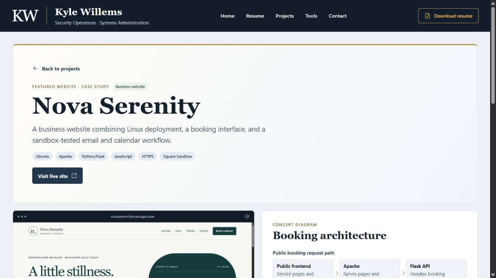

# Kyle Willems | Cybersecurity & IT Portfolio

A static React and Tailwind CSS portfolio with a scrollable resume, eight expandable project cards, and two standalone case studies. The layout stacks the resume and projects on smaller screens. [Live portfolio](https://kyle-willems-portfolio.vercel.app/) · [Nova Serenity business website](https://www.novaserenitymassage.com/)

## Explore the source build

| Local route | What it shows |
| --- | --- |
| `/` | Resume panel, technical projects, and Open Source & Tools |
| `/projects/nova-serenity/` | A dated homepage capture, the Apache and Flask booking architecture, and the historical Square Sandbox walkthrough |
| `/projects/home-soc/` | Verified Linux agent connectivity, Windows setup in progress, and planned detection validation |
| `/resume/` | The approved redacted public resume in HTML, with a PDF download |



[Mobile Tools screenshot](docs/screenshots/tools-mobile.jpg) · [Architecture and file map](docs/architecture.md)

## Run locally

Use Node.js 24 and pnpm 11.25.0. From the repository root, install the locked dependencies and start the development server.

```sh
pnpm install --frozen-lockfile
pnpm dev
```

Open the URL printed by Vite, normally `http://127.0.0.1:4173/`. Add the local route above to open either case study directly.

## Verify the build

```sh
pnpm check:content
pnpm check:resume
pnpm build
pnpm check:public
```

Stop the development server before running `pnpm preview` to inspect `dist/` locally. The included **Verify portfolio** GitHub Actions workflow is configured to run these checks on pull requests and pushes to `main`. It uses locked dependencies and read-only repository permissions. The checks cover project content, resume consistency, and the static build's required pages and public-file safety rules. Review external links, the rendered site, and the resume PDF separately.

## Linux toolkit

The toolkit provides three read-only Bash scripts for host metrics, selected systemd services, and a small security baseline. Run the scripts separately from the website using a regular user account. Local verification covered Bash syntax and synthetic fixtures. The toolkit workflow is configured to run ShellCheck and smoke checks on Ubuntu 24.04. [Toolkit README](toolkit/README.md) · [Ubuntu verification workflow](.github/workflows/verify-toolkit.yml)

## Contributions and licensing

This source package includes the redacted public resume data and the reviewed HTML and PDF. The MIT license covers original portfolio and toolkit software and technical setup documentation. Resume data and exports, case-study prose, screenshots, Nova Serenity branding, and third-party materials retain their respective rights. [MIT license](LICENSE) · [Rights and scope notice](NOTICE.md)

[Contribution guide](CONTRIBUTING.md)
