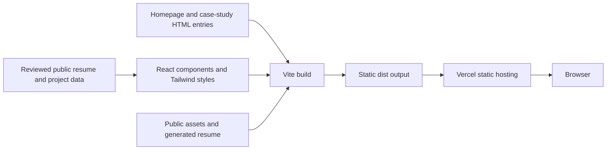

# Portfolio architecture

The portfolio is a static Vite multi-page build. React renders each page from shared public content. Tailwind utilities and local styles provide the responsive layout. The build produces `dist/` for static hosting on Vercel. [Vite multi-page build documentation](https://vite.dev/guide/build.html#multi-page-app)



## Pages and data

| Source | Responsibility |
| --- | --- |
| `index.html` and `src/App.jsx` | Main site with independent desktop scroll areas, expandable projects, and navigation |
| `projects/nova-serenity/index.html` | Local `/projects/nova-serenity/` entry with page-specific share metadata |
| `projects/home-soc/index.html` | Local `/projects/home-soc/` entry with page-specific share metadata |
| `src/case-study-routes.js` | Shared route paths for Vite and homepage links |
| `src/main.jsx` | Selects the page using the HTML entry's case-study marker |
| `src/content.js` | Reviewed resume data, project summaries, and case-study sections |
| `src/OpenSourceTools.jsx` | Homepage overview of the separately run Bash utilities |
| `public/resume/` | Generated HTML, stylesheet, and PDF for the redacted public resume |

Each case-study entry imports the same client bundle and selects the corresponding project record. The portfolio serves its own Nova Serenity screenshot. A visit to the business site opens a separate website. The historical email, calendar, and Square Sandbox flow is case-study content. The portfolio itself serves static files and requires no runtime environment variables.

## Resume generation

The source package includes the approved public resume data and reviewed exports. Regenerate the public HTML and PDF after approved resume changes using Node.js and Python 3 with ReportLab.

```sh
node scripts/export-resume.mjs
python scripts/build-resume.py
pnpm check:resume
```

Review the rendered PDF pages, extracted text, and standalone HTML. The resume consistency check confirms that the data and generated files match their recorded hashes. The content check separately protects the Army role heading and five source bullets.

## Build and hosting checks

`vercel.json` sets `dist/` as the output directory, applies shared security response headers, caches hashed assets, and sets the resume PDF download filename. Local production preview uses the same shared security headers. Vercel applies the path-specific caching and download rules. [Vercel static configuration](https://vercel.com/docs/project-configuration/vercel-json)

The GitHub Actions workflow is configured to verify public content and resume consistency, build the site, and check the static output. The public-file check covers required pages, file types, source maps, and common private-data patterns. External service availability, browser behavior, and the PDF's text, metadata, and layout are separate review steps.

The Bash toolkit lives under [`toolkit/`](../toolkit/README.md) and runs separately on Linux. Its synthetic verification cases exercise command output and exit codes. The Vite build serves the toolkit overview and keeps the shell source in the repository.
